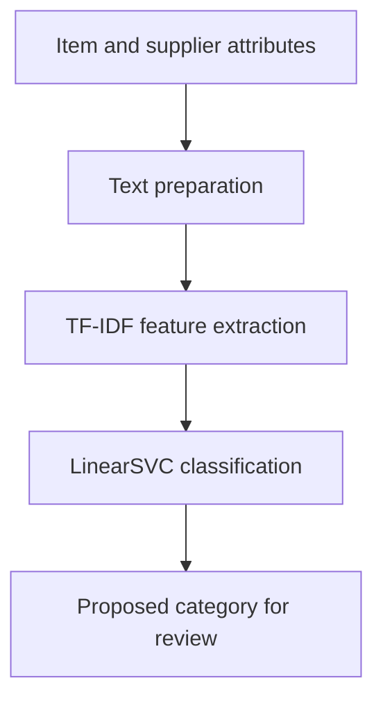

[README.md](https://github.com/user-attachments/files/30506919/README.md)
# Commercial Item Categorisation

Machine-learning proof of concept for automatically proposing procurement item
categories from short, inconsistent product descriptions and supplier metadata.

The project was developed from a real operational analytics problem in a
healthcare supply-chain environment. The public repository intentionally
excludes the underlying commercial datasets. The notebook demonstrates the
analytical approach, model selection and evaluation methodology.

## Business problem

Large procurement catalogues contain thousands of items supplied by different
manufacturers and vendors. Inconsistent descriptions and missing categories make
spend analysis, inventory reporting and supplier comparisons difficult.

The objective was to create a scalable workflow that:

- learns from previously categorised items;
- combines product, manufacturer and vendor information;
- proposes categories for new or uncategorised records;
- supports human review rather than replacing subject-matter expertise; and
- improves the consistency of downstream reporting.

## Solution overview



The modelling workflow:

1. Combines item description, manufacturer name, manufacturer catalogue number
   and vendor name into one text feature.
2. Splits labelled records into training and holdout datasets.
3. Converts text into numerical features using TF-IDF.
4. Trains a Linear Support Vector Classifier (`LinearSVC`).
5. Evaluates predictions with accuracy, precision, recall and F1 scores.
6. Applies the trained pipeline to new records and exports the proposed
   categories for expert validation.

## Verified project scale and results

| Measure | Result |
| --- | ---: |
| Labelled training records | 45,697 |
| Target categories | 886 |
| Holdout proportion | 20% |
| Holdout records | 9,140 |
| Accuracy | 0.75 |
| Weighted F1 score | 0.73 |
| Macro F1 score | 0.41 |
| New records processed | 16,572 |

The weighted results show that the model performs well on frequently occurring
categories. The lower macro F1 score reflects a highly imbalanced long-tail
taxonomy in which many categories contain very few examples. For this reason,
the model output should be treated as a recommendation for human review.

## Technology

- Python
- pandas and NumPy
- scikit-learn
- `TfidfVectorizer`
- `LinearSVC`
- Jupyter Notebook
- classification reports and holdout evaluation

## Expected private-data schema

The commercial data is not distributed with this repository. To adapt the
workflow to another dataset, provide equivalent fields:

| Field | Purpose |
| --- | --- |
| `Description1` | Primary item description |
| `ManufacturerName` | Manufacturer context |
| `ManuCatNo` | Manufacturer catalogue identifier |
| `VendorName` | Supplier context |
| `Category` | Training target; required only for labelled records |

Only the fields used by the modelling workflow should be supplied. Personal,
financial or commercially sensitive attributes should not be committed to a
public repository.

## Repository contents

- [`Item Categorisation Presentation.ipynb`](./Item%20Categorisation%20Presentation.ipynb) -
  exploratory modelling, evaluation and batch prediction workflow.
- `README.md` - project context, methodology, results and limitations.

## Running the notebook

Create a Python environment and install the core dependencies:

```bash
python -m venv .venv
source .venv/bin/activate
python -m pip install pandas numpy scikit-learn matplotlib seaborn jupyter
jupyter notebook
```

On Windows PowerShell, activate the environment with:

```powershell
.\.venv\Scripts\Activate.ps1
```

The notebook expects private training and prediction files that follow the
schema above. These files are intentionally unavailable in the public
repository. A synthetic-data example is planned to make the workflow fully
reproducible without exposing commercial information.

## Limitations

- The target taxonomy is severely imbalanced, with many rare categories.
- A simple random holdout split may not represent every low-frequency class.
- Accuracy and weighted F1 are influenced by the largest categories.
- `LinearSVC` does not provide calibrated probabilities by default.
- The current output is designed for expert review, not fully autonomous
  classification.
- The notebook is a proof of concept rather than a production API or packaged
  application.

## Recommended next improvements

- Add a synthetic dataset and an end-to-end reproducible example.
- Consolidate or separately handle categories with insufficient training data.
- Compare hierarchical classification and alternative NLP models.
- Add calibrated confidence scores and a low-confidence review queue.
- Report top-k accuracy alongside macro and weighted metrics.
- Separate training and inference into reusable Python modules.
- Add automated tests, model versioning and data-quality checks.

## Data privacy

The original project used commercially sensitive procurement data. Raw data,
model inputs and prediction exports must remain outside this repository.
Notebook outputs should be cleared before every public commit, and any example
records should be synthetic or fully anonymised.

## Author

[Tomasz Kaczmarski](https://github.com/tomaszkaczma)  
Data Scientist and Senior Analytics Professional
