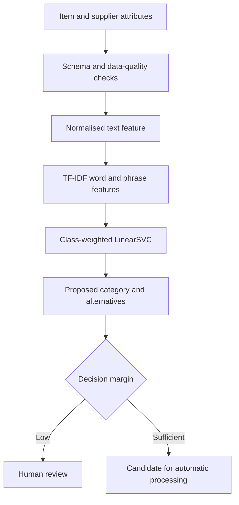

# Procurement Item Categorisation

[](https://www.python.org/)
[](https://scikit-learn.org/)
[](https://github.com/tomaszkaczma/Item-Categorisation/actions/workflows/tests.yml)
[](#project-status)

A reproducible machine-learning pipeline for proposing procurement item
categories from inconsistent product descriptions and supplier metadata.

The project originated from a commercial supply-chain analytics problem. The
public version contains only reusable code and synthetic examples—no source
records, prediction exports or trained models from the commercial environment.

## Business problem

Procurement catalogues often contain:

- incomplete or inconsistent product descriptions;
- several naming conventions for the same manufacturer;
- catalogue numbers embedded in free text;
- missing or inconsistent category assignments;
- a long-tail taxonomy with hundreds of rare categories.

These issues reduce the quality of spend analysis, inventory reporting,
supplier comparison and category-management decisions.

The objective is to propose likely categories for expert review while retaining
the original row order and highlighting uncertain predictions.

## Solution



The implementation:

1. Combines description, manufacturer, catalogue number and vendor fields.
2. Converts missing metadata to empty text rather than the token `nan`.
3. Keeps singleton categories in training while creating a stratified holdout
   for categories that can be evaluated.
4. Trains a TF-IDF and LinearSVC pipeline with class weighting.
5. Reports accuracy, macro/weighted F1 and top-3/top-5 accuracy.
6. Derives a review threshold from holdout decision margins.
7. Exports the proposed category, margin, review flag and two alternatives.
8. Assigns predictions directly by row—there is no merge on non-unique text.

## Repository structure

```text
.
├── src/item_categorisation/
│   ├── features.py       # schema checks and text construction
│   ├── model.py          # splitting, modelling, evaluation and review logic
│   ├── training.py       # training command and model bundle creation
│   ├── prediction.py     # row-preserving batch prediction
│   └── synthetic.py      # non-commercial demonstration data
├── tests/                # unit and end-to-end tests
├── examples/data/        # generated synthetic CSV files
├── .github/workflows/    # continuous-integration tests
├── Item Categorisation Presentation.ipynb
├── pyproject.toml
└── requirements.txt
```

## Quick start

Clone the repository and create a virtual environment:

```bash
git clone https://github.com/tomaszkaczma/Item-Categorisation.git
cd Item-Categorisation

python -m venv .venv
source .venv/bin/activate
python -m pip install --upgrade pip
pip install -e ".[dev]"
```

Windows PowerShell activation:

```powershell
.\.venv\Scripts\Activate.ps1
```

Generate the synthetic demonstration data:

```bash
item-cat-generate
```

Train and evaluate the model:

```bash
item-cat-train \
  --data examples/data/training_synthetic.csv \
  --output-dir artifacts
```

Apply the trained model:

```bash
item-cat-predict \
  --model artifacts/item_category_model.joblib \
  --data examples/data/prediction_synthetic.csv \
  --output outputs/proposed_categories.csv
```

The same workflow is demonstrated in
[`Item Categorisation Presentation.ipynb`](./Item%20Categorisation%20Presentation.ipynb).

## Expected data schema

The default model uses:

| Field | Required for training | Required for prediction | Purpose |
| --- | :---: | :---: | --- |
| `Description1` | Yes | Yes | Primary item description |
| `ManufacturerName` | Yes | Yes | Manufacturer context |
| `ManuCatNo` | Yes | Yes | Manufacturer catalogue identifier |
| `VendorName` | Yes | Yes | Supplier context |
| `Category` | Yes | No | Target label |

Values within the feature columns may be missing, but every prediction row must
contain at least one usable text value.

## Training outputs

The training command writes:

```text
artifacts/
├── item_category_model.joblib
├── training_summary.json
└── per_category_metrics.csv
```

`training_summary.json` records:

- training and holdout row counts;
- category and singleton counts;
- accuracy, macro F1 and weighted F1;
- top-3 and top-5 accuracy;
- decision-margin distribution;
- review threshold, expected coverage and expected accepted accuracy.

## Prediction outputs

The prediction export preserves every input row and adds:

| Field | Meaning |
| --- | --- |
| `ProposedCategory` | Highest-scoring model category |
| `PredictionMargin` | Difference between the two strongest decision scores |
| `ReviewRecommended` | Whether the margin is below the validation threshold |
| `AlternativeCategory1` | Second-highest category |
| `AlternativeCategory2` | Third-highest category |

The margin is not a probability. The review threshold must be monitored and
revalidated when the taxonomy, supplier base or item descriptions change.

## Historical commercial experiment

The original proof of concept used a private healthcare supply-chain dataset:

| Measure | Historical result |
| --- | ---: |
| Labelled records | 45,697 |
| Categories | 886 |
| Holdout records | 9,140 |
| Accuracy | 0.75 |
| Weighted F1 | 0.73 |
| Macro F1 | 0.41 |
| New records processed | 16,572 |

These values are historical context, not results reproduced by the synthetic
example. The difference between weighted and macro F1 reflects the highly
imbalanced long-tail taxonomy.

## Testing

Run:

```bash
pytest
```

The test suite checks:

- missing values do not become `nan` text tokens;
- missing schema fields produce clear errors;
- singleton categories remain in training;
- predictions preserve row count;
- alternatives and review fields are produced;
- the synthetic training and prediction workflow runs end to end.

GitHub Actions runs the same tests after every push and pull request.

## Privacy and security

- Never commit commercial source data or prediction exports.
- Never commit trained model bundles: TF-IDF vocabularies can contain sensitive
  product, supplier or catalogue information.
- Treat `joblib` files as executable artefacts and load models only from trusted
  sources.
- Keep high-value or low-margin items in a human-review workflow.
- Log model version, taxonomy version and reviewer corrections in production.

The included `.gitignore` excludes common private data and model artefacts.

## Limitations

- Random holdout evaluation may overstate performance when duplicate or related
  item descriptions appear across splits.
- Categories with one observation cannot be measured in the holdout.
- LinearSVC decision margins are not calibrated probabilities.
- Performance depends on taxonomy quality and the completeness of input text.
- Historical results cannot be reproduced without the private source data.
- The project is a machine-learning proof of concept, not a production service.

## Recommended next steps

- Add grouped or time-based validation using stable item identifiers.
- Establish a taxonomy policy for categories with insufficient examples.
- Compare calibrated LinearSVC, logistic regression and modern text embeddings.
- Add hierarchical evaluation when parent/child category relationships exist.
- Track accepted accuracy and review coverage after deployment.
- Capture reviewer corrections for controlled retraining.
- Add model/data versioning and drift monitoring.
- Expose prediction through an authenticated internal API only after governance
  and security review.

## Project status

Human-in-the-loop research prototype with a runnable synthetic demonstration.
The baseline is deliberately transparent and appropriate for validating the
business workflow before considering more complex NLP architectures.

## Author

**Tomasz Kaczmarski**

- [GitHub profile](https://github.com/tomaszkaczma)

## Licence

No licence is currently included. Add an appropriate licence before permitting
reuse or redistribution.
